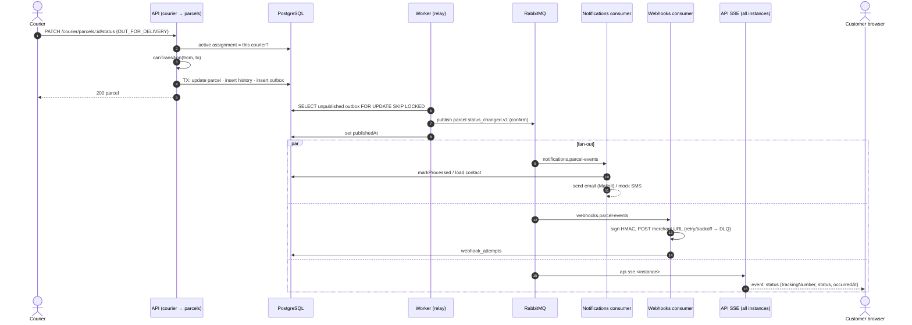
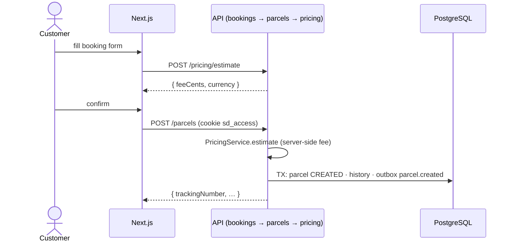
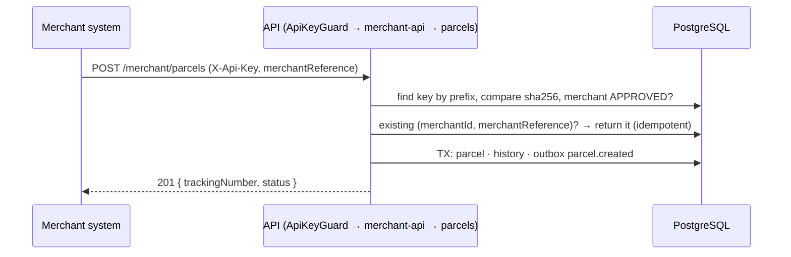
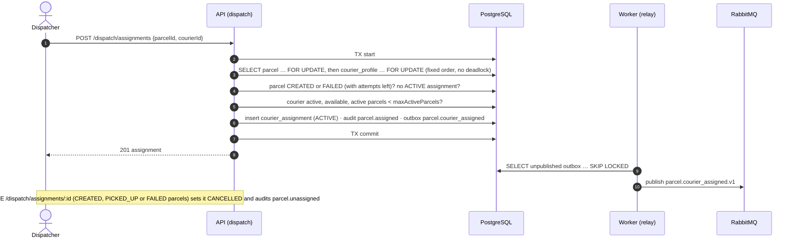
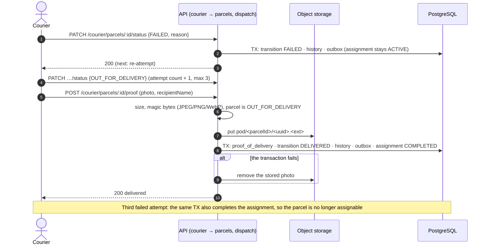

# Sequence diagrams

## Courier status update → tracking, notification, webhook



## Customer booking



## Merchant API order



## Courier assignment



## Delivery with proof, failure and re-attempt



## Webhook retry and dead letter queue

```mermaid
sequenceDiagram
  autonumber
  participant MQ as RabbitMQ
  participant WH as Webhooks consumer
  participant M as Merchant endpoint
  participant DB as PostgreSQL
  MQ->>WH: webhooks.parcel-events (x-attempt: 1)
  WH->>DB: endpoints of this merchant subscribed to the event
  WH->>M: POST signed body (t=<ts>,v1=<hmac>), timeout
  WH->>DB: webhook_attempts row (status, response code, duration)
  alt 2xx
    WH->>MQ: ack (SUCCEEDED)
  else 4xx (except 408/429)
    WH->>MQ: ack (FAILED, no retry: the merchant must fix their endpoint)
  else timeout, 5xx, 408, 429
    WH->>MQ: publish to retry queue (delay 10 s, then 1 min, then 5 min; x-attempt + 1)
    MQ-->>WH: message returns after the delay (dead-letters back)
    Note over WH,M: after the last retry
    WH->>MQ: publish to webhooks.parcel-events.dlq
    WH->>DB: attempt marked DEAD
  end
  Note over DB: An admin can re-send a DEAD or FAILED attempt: POST /admin/ops/webhook-attempts/:id/retry (audited)
```
