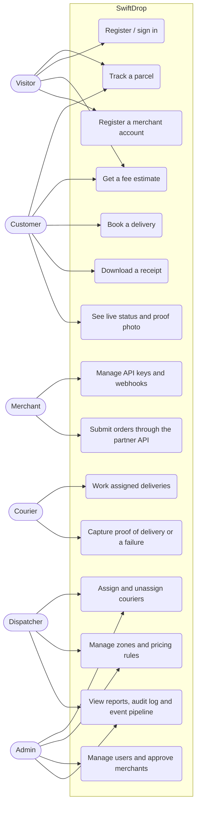

# Use cases

Who does what in SwiftDrop. Every use case lists the screen or endpoint that implements it and the
rule that protects it. Role checks are enforced on the server (`@Roles` plus object-level checks);
the UI only hides what a person can't do anyway.

## Overview

## Catalogue

| #   | Use case                                       | Actor             | Main flow                                                                                                                  | Rules and exceptions                                                                                                                    |
| --- | ---------------------------------------------- | ----------------- | -------------------------------------------------------------------------------------------------------------------------- | --------------------------------------------------------------------------------------------------------------------------------------- |
| 1   | Track a parcel                                 | Anyone            | Enter a tracking number (`/track`), see status and timeline; the page updates live (SSE).                                  | Public view has no names, phone numbers or full addresses. Unknown number → 404.                                                        |
| 2   | Register / sign in                             | Visitor           | Register as a customer, or sign in with email and password or Google.                                                      | Passwords 8–128 characters, hashed with argon2id. Refresh tokens rotate; reuse revokes every session. Disabled accounts can't sign in.  |
| 3   | Get a fee estimate                             | Visitor, Customer | Enter cities, size and weight → `POST /pricing/estimate`.                                                                  | Fee comes from the pricing rules only. A city outside every active zone → `ZONE_NOT_SERVICED`.                                          |
| 4   | Book a delivery                                | Customer          | Fill the form, get a price, confirm → parcel `CREATED`, tracking number `SD#########`.                                     | The fee is recalculated on the server; a client-sent fee is rejected. The booking is also saved as an event in the same transaction.    |
| 5   | Download a receipt                             | Customer          | Open a parcel, download the PDF.                                                                                           | Only the owner; another customer gets 404.                                                                                              |
| 6   | See live status and proof photo                | Customer          | Open the parcel; status and timeline follow the courier; after delivery the proof photo is shown.                          | Photo visible to the owner, the courier who took it, dispatchers and admins only. `Cache-Control: private, no-store`.                   |
| 7   | Register a merchant account                    | Visitor           | Sign up as a merchant; the account waits for approval.                                                                     | Rate limited (10 per minute). Until approved, the API key can't create parcels (`MERCHANT_NOT_APPROVED`).                               |
| 8   | Manage API keys and webhooks                   | Merchant          | Generate a key (shown once), add webhook endpoints (secret shown once), rotate secrets, view delivery attempts.            | Keys stored as hashes. Webhook URLs must be HTTPS in production and may not point at internal addresses. All changes are audited.       |
| 9   | Submit orders through the partner API          | Merchant system   | `POST /merchant/parcels` with `X-Api-Key` and a `merchantReference`.                                                       | Idempotent on `merchantReference` (200 for a repeat). A merchant only ever sees its own parcels (404 otherwise). Rate limited.          |
| 10  | Work assigned deliveries                       | Courier           | See the list (`/courier`), open a parcel, mark picked up → in transit → out for delivery.                                  | Only the assigned courier; others get 404. Only valid next steps are offered; the API enforces the lifecycle.                           |
| 11  | Capture proof or a failure                     | Courier           | Deliver with recipient name and photo, or report a problem with a reason. After a failure the same courier can re-attempt. | Photo checked by its first bytes (JPEG, PNG, WebP), max 5 MB. Three attempts at most, then the parcel stays failed.                     |
| 12  | Assign and unassign couriers                   | Dispatcher, Admin | See unassigned parcels, pick a courier with free capacity; take a parcel back from the "Active assignments" list.          | One active courier per parcel; courier must be active, available and under their limit. Unassign only before the parcel is on the road. |
| 13  | Manage zones and pricing rules                 | Dispatcher, Admin | Create and edit zones and rules; preview the effect with an estimate.                                                      | A city belongs to one active zone. `validFrom` can't be later than `validTo`. Every change is audited in the same transaction.          |
| 14  | Manage users and approve merchants             | Admin             | Create staff, change roles, enable or disable accounts (filter by role and status); approve, reject or suspend merchants.  | Admins can't change their own role or status. Disabling revokes sessions.                                                               |
| 15  | View reports, audit log and the event pipeline | Admin, Dispatcher | Delivery, volume and courier reports; audit log with filters (admin); outbox, queues and webhook attempts (admin).         | Reports: admin and dispatcher. Audit log and event pipeline: admin only. Audit entries never contain secrets.                           |
